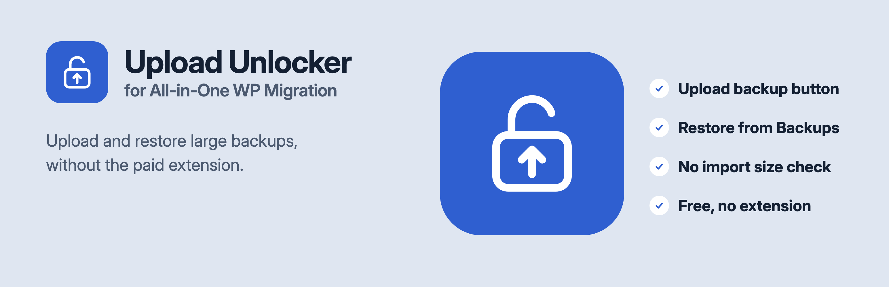
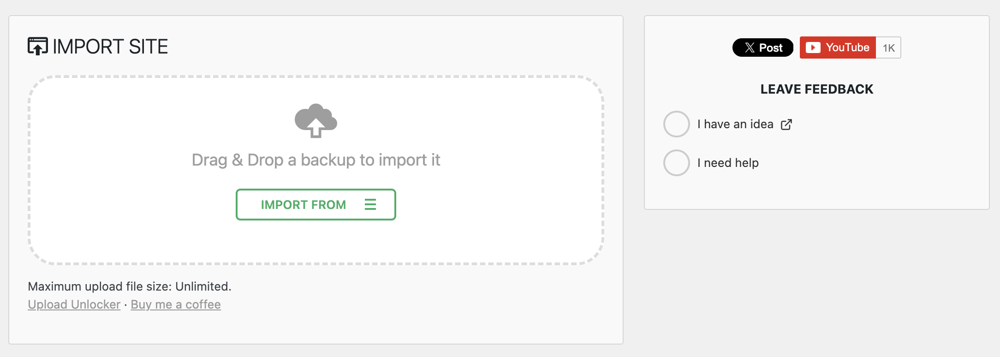

# Upload Unlocker: restore large All-in-One WP Migration backups for free



Upload Unlocker for All in All Migration is a free WordPress plugin for [All-in-One WP Migration](https://wordpress.org/plugins/all-in-one-wp-migration/). It lets you import and restore a `.wpress` backup that's bigger than your server's upload limit, without the paid Unlimited Extension, without SFTP, and without editing php.ini. You upload the backup from the Backups page in small pieces, then click Restore. No All-in-One WP Migration files are changed.

[](readme.txt)
[](https://wordpress.org/download/)
[](https://www.php.net/)
[](LICENSE)



## Restore a backup bigger than your upload limit

1. Install and activate Upload Unlocker next to All-in-One WP Migration.
2. Go to **All-in-One WP Migration > Backups** and click **Upload backup**.
3. Choose your `.wpress` file and keep the page open. It shows the percent uploaded, then reloads with the backup in the list.
4. Click **Restore** next to the backup and confirm.

A backup under your server's limit still imports from **All-in-One WP Migration > Import** as usual.

## What It Does

| Feature | How |
|---|---|
| **No import size check** | Removes the JavaScript file-size gate on the Import page. Your server's PHP limits still apply (see below) |
| **Upload backup button** | Sends a `.wpress` file to the Backups page in pieces of up to 5 MB, each under your server's PHP limits. If nginx or another web server has a smaller limit, it steps down to smaller pieces on its own |
| **Restore from Backups** | Restore on the Backups page runs for any `.wpress` file in `wp-content/ai1wm-backups`, with no upload |
| **Higher PHP memory** | Calls `wp_raise_memory_limit()` when a migration page loads |
| **Clean UI** | Replaces the upsell notice with a simple "Unlimited" confirmation |
| **Hides promo menus** | Removes the "Schedules" and "Reset Hub" upsell submenus |

## How It Works

On the Import page, the plugin lifts the JavaScript check that compares the file size against the server's reported limit. On the Backups page, it defines the `Ai1wm.FreeExtensionRestore` class the free plugin checks for, so Restore runs the plugin's own import from the file on disk instead of showing the paid extension notice. It uses standard WordPress hooks:

- `upload_size_limit` filter
- `wp_add_inline_script()`
- `wp_raise_memory_limit()`
- the `ai1wm_backups_left_end` action, for the Upload backup button
- the `wp_ajax_aiam_upload_chunk` action, which saves each uploaded piece

The upload endpoint checks a nonce and the same permission as the Backups page on every request, accepts only `.wpress` file names, writes only to the backups folder, and never overwrites a backup that's already there.

No migration plugin files are touched. Everything is scoped to migration admin screens only.

### The Import page still has your server's limits

The free All-in-One WP Migration plugin sends the whole backup in one request from the Import page. This plugin can't change your server's `post_max_size` or `upload_max_filesize`, so a backup bigger than either one still fails on the Import page, even though it says Unlimited.

For a large backup, use the Upload backup button on the Backups page, as in the steps above. The server needs to accept uploads of at least 1 MB. You can also copy the file into `wp-content/ai1wm-backups` with SFTP, or raise both PHP limits above the backup size so the Import page works.

Tested on October 30, 2026 with WordPress 7.1.4, PHP 8.3, All-in-One WP Migration 7.113, an 8 MB server limit, and a 36 MB backup. The Import page failed, and the Upload backup button plus Restore brought the whole site across. The full walkthrough is in [Increase the All-in-One WP Migration upload limit for free](https://shameemreza.com/increase-upload-limit-for-all-in-one-wp-migration-plugin/).

## Requirements

- WordPress 5.0+
- PHP 7.4+
- [All-in-One WP Migration](https://wordpress.org/plugins/all-in-one-wp-migration/) (free version) installed and active

## Installation

### As a Plugin

1. Download [upload-unlocker-for-aiam.zip](https://github.com/shameemreza/upload-unlocker-for-aiam/releases/latest/download/upload-unlocker-for-aiam.zip) from the latest release.
2. In WordPress, go to **Plugins > Add New Plugin > Upload Plugin**, choose the zip, and click **Install Now**.
3. Activate **Upload Unlocker for All in All Migration**.
4. For a large backup, go to **All-in-One WP Migration > Backups**, click **Upload backup**, then click **Restore** next to it. A backup under your server's limit imports from **All-in-One WP Migration > Import** as usual.

### As a Code Snippet

If you prefer not to install a plugin, add this to your theme's `functions.php` or use a code-snippets plugin like [SnipDrop](https://github.com/shameemreza/snipdrop). The snippet removes the size check, enables Restore and raises memory. It doesn't include the Upload backup button, so you'd copy large backups into `wp-content/ai1wm-backups` with SFTP:

<details>
<summary>Show snippet</summary>

```php
// Raise the WordPress-reported upload limit on migration pages.
add_filter( 'upload_size_limit', function ( $limit ) {
    $page = isset( $_GET['page'] ) ? sanitize_text_field( wp_unslash( $_GET['page'] ) ) : '';
    if ( str_starts_with( $page, 'ai1wm_' ) ) {
        return 9007199254740991; // Effectively unlimited
    }
    return $limit;
} );

// Replace the upsell text with a simple confirmation.
add_filter( 'ai1wm_pro', function () {
    return '<p class="max-upload-size">Maximum upload file size: Unlimited.</p>';
}, 20 );

// Override the client-side file-size gate and enable backup restore.
add_action( 'admin_enqueue_scripts', function () {
    if ( wp_script_is( 'ai1wm_import', 'enqueued' ) || wp_script_is( 'ai1wm_import', 'registered' ) ) {
        wp_add_inline_script(
            'ai1wm_import',
            'if(typeof ai1wm_uploader!=="undefined"){ai1wm_uploader.max_file_size=Math.max(ai1wm_uploader.max_file_size,9007199254740991);}',
            'after'
        );
    }
    if ( wp_script_is( 'ai1wm_backups', 'enqueued' ) || wp_script_is( 'ai1wm_backups', 'registered' ) ) {
        $js = '(function(){if(typeof Ai1wm==="undefined"||typeof Ai1wm.Import==="undefined")return;'
            . 'Ai1wm.FreeExtensionRestore=function(a,s){'
            . 'var m=new Ai1wm.Import();'
            . 'm.setParams([{name:"storage",value:Date.now().toString()},{name:"archive",value:a},{name:"ai1wm_manual_restore",value:"1"}]);'
            . 'm.start([{name:"priority",value:10}]);};})();';
        wp_add_inline_script( 'ai1wm_backups', $js, 'after' );
    }
}, 99 );

// Raise PHP memory limit on migration pages.
add_action( 'admin_init', function () {
    $page = isset( $_GET['page'] ) ? sanitize_text_field( wp_unslash( $_GET['page'] ) ) : '';
    if ( str_starts_with( $page, 'ai1wm_' ) ) {
        wp_raise_memory_limit( 'admin' );
    }
} );
```

</details>

## FAQ

**Will this work if my hosting has a low `upload_max_filesize`?**

On the Backups page, yes. Upload backup sends the file in pieces that fit under your limits, and Restore reads it from disk. The server needs to accept uploads of at least 1 MB. On the Import page, no. The free All-in-One WP Migration plugin sends the whole file in one request, so a backup over `upload_max_filesize` or `post_max_size` fails there.

**Where do uploaded backups go?**

Into `wp-content/ai1wm-backups`, the same folder All-in-One WP Migration uses for Create backup. They stay in the list after a restore, so delete them there when you no longer need them.

**Who can upload backups?**

Only users All-in-One WP Migration lets import a site: administrators on a single site, and super admins on multisite.

**My host uses nginx with a 1 MB upload limit. Does Upload backup still work?**

Yes. When nginx turns a piece down with a 413, the button halves the piece size and tries again, down to 256 KB, then keeps the size that works. If even 256 KB is turned down, it stops and tells you to ask your host to raise `client_max_body_size`. Developers can set the piece size with the `aiam_upload_chunk_size` filter, in bytes.

**Do I still need to change php.ini or .htaccess?**

Only to import through the Import page. Raise both `upload_max_filesize` and `post_max_size` above your backup size. See the [readme.txt](readme.txt) for the settings. Restoring from the Backups page needs neither.

## Support

- [Report an issue](https://github.com/shameemreza/upload-unlocker-for-aiam/issues)
- [Buy me a coffee](https://ko-fi.com/shameemreza)

## License

GPL-2.0-or-later. See [LICENSE](LICENSE) for details.
